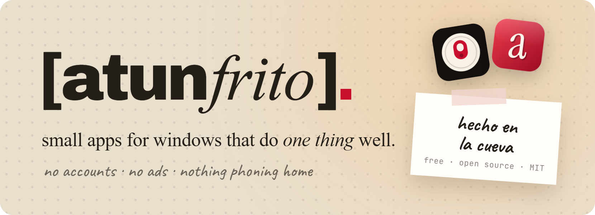
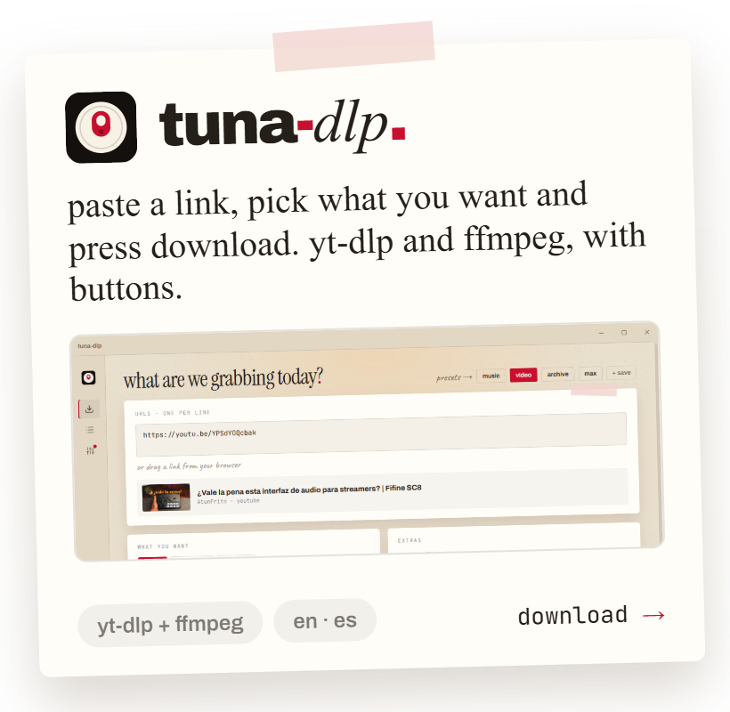
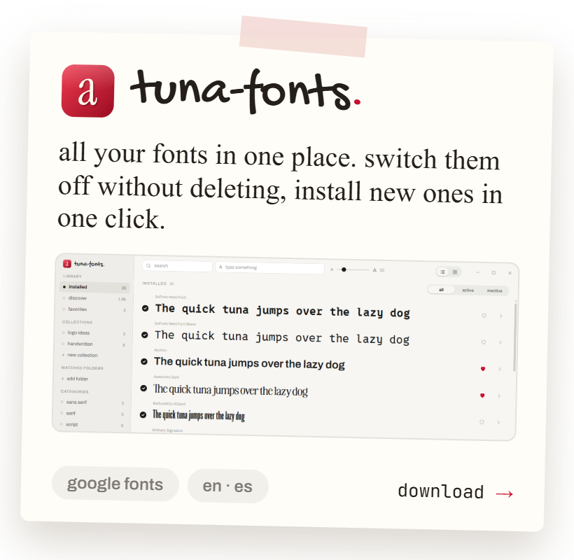

<a href="https://atunfrito.es">
  <picture>
    <source media="(prefers-color-scheme: dark)" srcset="assets/banner-dark.png">
    
  </picture>
</a>

 

hi, i'm **atunfrito**. i make small, free apps for windows: each one does one job, looks nice doing it, and stays out of your way.
no accounts, no ads, no telemetry. everything runs on your computer and the code is all here, under MIT.

  <a href="https://github.com/atunfrito/tuna-dlp">
    <picture>
      <source media="(prefers-color-scheme: dark)" srcset="assets/dlp-dark.png">
      
    </picture></a><a href="https://github.com/atunfrito/tuna-fonts">
    <picture>
      <source media="(prefers-color-scheme: dark)" srcset="assets/fonts-dark.png">
      
    </picture>
  </a>

**how i make them**

- **it all stays on your computer.** the only network calls are the ones the app obviously needs.
- **one job each.** if it needs a manual, i've done it wrong.
- **english and spanish**, light and dark, always.

more on the way.  ·  [atunfrito.es](https://atunfrito.es)  ·  [youtube](https://youtube.com/@atunfrito)

<b>en español</b>

 

hola, soy **atunfrito**. hago apps pequeñas y gratuitas para windows: cada una hace una cosa, la hace bonita y no molesta.
sin cuentas, sin anuncios, sin telemetría. todo funciona en tu ordenador y el código está aquí, con licencia MIT.

- [**tuna-dlp**](https://github.com/atunfrito/tuna-dlp): pega un enlace, elige qué quieres y dale a descargar. yt-dlp y ffmpeg, con botones.
- [**tuna-fonts**](https://github.com/atunfrito/tuna-fonts): todas tus fuentes en un sitio. desactívalas sin borrarlas e instala nuevas con un clic.

vienen más.

 

  <picture>
    <source media="(prefers-color-scheme: dark)" srcset="assets/foot-dark.png">
    
  </picture>

