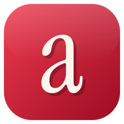

**hola, soy atunfrito.** i make small, free apps for windows. 
each one does one job, looks nice doing it and stays out of your way.

 

<table>
<tr>
<td width="50%" valign="top">

### [tuna&#8209;dlp](https://github.com/atunfrito/tuna-dlp)

a simple windows app for **yt-dlp** and **ffmpeg**. 
paste a link, pick what you want, press download.

</td>
<td width="50%" valign="top">

### [tuna&#8209;fonts](https://github.com/atunfrito/tuna-fonts)

a font manager for **windows 10 and 11**. 
switch fonts off without deleting them, install google fonts in one click.

</td>
</tr>
</table>

 

<table>
<tr>
<td width="33%" valign="top"><b>it stays on your computer</b> no accounts, no telemetry. the only network calls are the ones the app obviously needs.</td>
<td width="33%" valign="top"><b>one job each</b> if it needs a manual, i've done it wrong.</td>
<td width="33%" valign="top"><b>english and spanish</b> light and dark, always. free and MIT licensed.</td>
</tr>
</table>

 

built with 

 

<b>en español</b>

 

hago apps pequeñas y gratuitas para windows. cada una hace una cosa, la hace bonita y no molesta.
sin cuentas, sin anuncios, sin telemetría. todo funciona en tu ordenador y el código está aquí, con licencia MIT.

- [**tuna-dlp**](https://github.com/atunfrito/tuna-dlp): pega un enlace, elige qué quieres y dale a descargar. yt-dlp y ffmpeg, con botones.
- [**tuna-fonts**](https://github.com/atunfrito/tuna-fonts): todas tus fuentes en un sitio. desactívalas sin borrarlas e instala nuevas con un clic.

